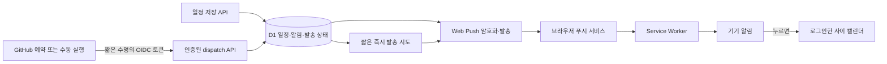

# 사이 알림 설계

작성 기준: 2026-11-05. 이 문서는 알림의 동작 계약과 운영 제약을 정리한다. 소스·로컬 검증·배포 성공과 실제 휴대폰 수신은 각각 별도의 확인 항목이며, 문서 작성만으로 운영 푸시 수신을 검증한 것은 아니다.

## 사용자 경험

앱 안의 알림함과 기기 푸시를 함께 제공한다. 브라우저 푸시를 허용하지 않아도 로그인한 사용자는 알림함에서 변경 내용을 확인한다. 알림함의 일정 내용은 기존 캘린더처럼 초대로 연결된 두 계정의 권한 안에서만 읽는다.

- **짝꿍의 일정 변경:** 다른 멤버가 일정을 추가·수정·삭제하면 해당 변경을 알린다. 내가 수행한 변경을 나에게 다시 보내지 않는다.
- **다가오는 두 사람의 일정:** 기본으로 `나`·`짝꿍`·`함께` 일정 모두 선택한 시각에 알린다. 짝꿍 일정의 미리 알림은 개인 설정에서 끌 수 있다.
- 미리 알림은 10분·30분·1시간·하루 전 중 선택한다. 종일 일정의 알림 시각과 방해금지 시간도 설정할 수 있다. 첫 기본값은 30분 전, 종일 오전 9시, 방해금지 끔이다.
- 잠금 화면의 일정 제목·메모 노출은 기본으로 끈다. 상세 미리보기를 켜지 않으면 푸시에는 일반 안내만 담고 앱에서 내용을 확인한다.
- 기기별로 알림 켜기·끄기·테스트를 제공한다. 알림 권한 요청은 가입 직후 자동으로 띄우지 않고 사용자의 버튼 동작에서 시작한다.

모든 일정 계산은 기존 앱과 같은 `Asia/Seoul`을 사용한다. 매월 말일·윤년·반복 종료일은 기존 반복 일정 전개 함수를 재사용한다. 반복 시리즈 수정·삭제 뒤에는 이전 시각의 푸시를 보내지 않아야 한다.

## 구성과 데이터 흐름

Firebase는 기존 사용자 인증에 계속 사용한다. 기기 알림 전송은 표준 Web Push와 VAPID를 사용하며 Firebase Cloud Messaging 서비스나 새 유료 데이터베이스를 필수로 추가하지 않는다.

D1에는 수신자별 알림, 읽음 상태, 설정, 기기 구독과 발송 상태를 보존한다. 빠른 발송 시도가 취소되더라도 다음 dispatch에서 재시도할 수 있어야 한다. 일정 저장의 재요청 때문에 알림이 중복 생성되지 않도록 일정 ID·변경 종류·revision·수신자에 대한 결정적인 중복 방지 키를 사용한다.

다가오는 일정은 `일정 ID + 반복 발생 날짜 + 수신자 + 알림 종류`로 식별한다. 생성·변경·삭제·설정 변경 뒤에 기존 상태와 맞지 않는 예약은 취소하거나 발송 직전 다시 검증한다. 오래된 예약의 제목만 믿고 삭제된 일정을 발송하지 않는다.

Cloudflare `waitUntil()`은 응답 뒤의 짧은 작업에 사용할 수 있지만 영구 스케줄러가 아니다. 응답 종료 후 연장은 최대 30초이며, 그 안에 끝나지 않은 작업은 취소될 수 있다. 그러므로 먼저 D1에 발송할 상태를 남기고 즉시 시도와 정기 재시도를 조합한다. [Cloudflare 실행 컨텍스트](https://developers.cloudflare.com/workers/runtime-apis/context/)

## 예약 실행 방식

Sites는 관리되는 Worker 배포다. 현재 Sites 호스팅 manifest와 도구에는 Worker Cron Trigger를 설정하는 계약이 없다. 소스에 `scheduled()`만 추가해도 운영 예약이 등록된다고 가정하지 않는다. 일반 Cloudflare Worker에는 별도의 cron 설정과 scheduled handler가 필요하다. [Cloudflare Cron Triggers](https://developers.cloudflare.com/workers/configuration/cron-triggers/)

이 버전은 공개 GitHub 저장소의 `.github/workflows/notifications.yml`을 결정적인 실행기로 사용한다. 매시 **2·7·12·…·57분 UTC**에 예약 실행하며, 수동 실행도 가능하다. 기본 브랜치 `main`에서만 운영 API 호출을 허용한다. 저장소 push 자체는 이 워크플로를 실행하지 않는다.

**5분 예약은 정확한 알람 시각을 보장하지 않는다.** GitHub의 실행 대기, 혼잡, 실패 또는 누락으로 더 늦어질 수 있다. 공개 저장소가 60일 동안 활동이 없으면 예약 워크플로가 자동 비활성화될 수 있다. UI와 안내에는 이 제약을 명시하고 운영자가 예약 상태를 점검해야 한다. [GitHub 예약 이벤트와 제한](https://docs.github.com/en/actions/reference/workflows-and-actions/events-that-trigger-workflows#schedule)

놓친 tick 때문에 발송할 알림이 사라지면 안 된다. 현재 시각과 D1의 미처리 상태를 기준으로 다시 조회하고, 이미 지난 일정에는 무의미한 늦은 푸시를 보내지 않는다. 알림함에는 사용자가 변경 이력을 확인할 수 있도록 보존한다.

첫 버전의 dispatch는 한 번에 **최대 50명**의 일정을 조회하고, 푸시 발송은 작은 별도 batch로 제한한다. GitHub의 한 실행은 남은 작업이 있으면 dispatch를 최대 3회 호출하며 전체 호출 시간은 140초 이내, 각 HTTP 요청은 최대 45초다. 제한에 걸린 나머지는 다음 실행에서 이어가고 오래된 항목부터 처리한다. 계정·기기 수가 이 처리량을 넘으면 한 바퀴 조회에 여러 tick이 필요해 지연이 커진다. 다음 확장 단계는 Cloudflare Queues 등 재시도 가능한 큐와 전용 분 단위 실행기다. 브라우저 타이머나 AI 대화의 반복 실행으로 이를 대체하지 않는다.

## GitHub 실행기의 신원 확인

장기 GitHub secret이나 배포 토큰을 저장하지 않는다. 워크플로에는 `contents: read`, `id-token: write`만 부여하고 네이티브 Node 단계에서 GitHub의 단기 OIDC 토큰을 요청한다. 토큰은 다음 API의 Authorization 헤더에만 전달한다.

`POST /api/internal/notifications/dispatch`

서버는 고정 GitHub JWKS에서 RS256 서명을 검증하고 다음 조건을 모두 확인한다.

| 조건 | 허용값 |
| --- | --- |
| issuer | `https://token.actions.githubusercontent.com` |
| audience | `https://sai-our-calendar.seonguk.chatgpt.site/notifications` |
| 저장소 | `kreativ-works/sai-calendar` |
| 저장소·조직 숫자 ID | 운영 환경에 설정한 불변 ID와 정확히 일치 |
| workflow | `kreativ-works/sai-calendar/.github/workflows/notifications.yml@refs/heads/main` |
| ref | `refs/heads/main` |
| 이벤트 | `schedule` 또는 `workflow_dispatch` |
| 시간 | 유효한 exp·iat, 발급 후 최대 10분 |

fork, 다른 워크플로, 다른 브랜치, pull request, push 이벤트의 토큰은 거부한다. JWKS 주소를 토큰이나 요청에서 선택하지 않는다. GitHub가 새 저장소에 사용하는 immutable subject 형식과 과거 형식의 차이에 의존하지 않고 저장소·조직 숫자 ID를 직접 확인한다. [GitHub OIDC claims와 단기 토큰](https://docs.github.com/en/actions/reference/security/oidc)

이 인증은 해당 워크플로의 실행 권한을 증명한다. 네트워크 재전송 자체를 제거하지는 않으므로 dispatch의 원자적 선점·중복 방지·재시도 상태가 별도로 필요하다. 워크플로 로그에는 처리 개수와 성공 여부만 기록하고 토큰·구독 endpoint·일정 내용·사용자 이메일은 출력하지 않는다.

## 모바일 Web Push

현재 표준 Web Push에는 HTTPS, 지원 브라우저, 기기 권한과 푸시 구독이 필요하다. Service Worker는 push를 받으면 즉시 `showNotification()`으로 사용자에게 보이는 알림을 표시한다. 서버 API 호출만 발생시키는 숨은 push로 사용하지 않는다. Safari는 사용자에게 보이는 알림 약속을 지키지 않으면 권한을 취소할 수 있다. Apple Developer Program 가입은 표준 Web Push의 필수 조건이 아니다. [Apple Web Push 안내](https://developer.apple.com/documentation/usernotifications/sending-web-push-notifications-in-web-apps-and-browsers)

**iPhone·iPad:** iOS·iPadOS 16.4 이상에서 홈 화면에 추가하고, 그 아이콘으로 연 웹앱 안에서 사용자가 알림 버튼을 눌러 허용하는 흐름을 안내한다. 일반 Safari 탭이나 모든 인앱 브라우저에서 같은 기능을 사용할 수 있다고 안내하지 않는다. manifest는 standalone 표시와 안정적인 앱 identity·아이콘을 유지한다. [WebKit의 iOS 홈 화면 Web Push 설명](https://webkit.org/blog/13878/web-push-for-web-apps-on-ios-and-ipados/)

Android와 데스크톱도 실제 `serviceWorker`, `PushManager`, `Notification` 지원 여부를 확인한다. 차단 상태에는 반복 권한 팝업 대신 기기 설정 안내를 표시한다. 네트워크·운영체제의 집중 모드·배터리 정책·브라우저 종료 정책에 따라 표시가 지연되거나 제한될 수 있다. 푸시 서비스의 접수 응답은 사용자가 알림을 보았다는 증거가 아니다.

SW는 캘린더·로그인·OAuth helper 응답을 캐시하지 않는다. 알림을 누르면 같은 origin의 `/app`만 열고, 필요한 경우 기존 로그인 흐름을 거친다. 알림 payload에 세션 토큰, 비밀번호, 초대 코드 또는 외부 이동 URL을 넣지 않는다.

## 암호화·구독·개인정보

Web Push payload는 매 전송의 P-256 ECDH 키와 구독의 인증 비밀을 조합하고 HKDF-SHA256 및 AES-128-GCM으로 암호화한다. VAPID용 장기 서명 키와 전송용 ECDH 키는 분리한다. VAPID 서명은 ES256, audience는 정확한 push endpoint origin, 만료는 24시간 이내여야 한다. [RFC 8291 암호화](https://www.rfc-editor.org/rfc/rfc8291), [RFC 8292 VAPID](https://www.rfc-editor.org/rfc/rfc8292)

구독 endpoint와 `auth` 키는 비밀 capability로 취급한다. 인증된 사용자만 자기 기기를 등록·삭제하고, 전송 시에도 구독의 현재 소유자와 수신자가 일치하는지 확인한다. 로그아웃과 계정 전환 시 이전 사용자의 구독이 같은 기기로 계속 전달되지 않도록 연결을 정리한다. 기본 상세 미리보기 끔은 이 권한 검사를 대신하지 않는다.

구독에서 받은 URL은 무조건 fetch하지 않는다. HTTPS, 허용 push 서비스 도메인, 기본 포트, credentials·fragment 없음, 유효한 P-256 키와 인증 비밀을 검사한다. 발송은 redirect를 따라가지 않아 내부 주소나 임의 외부 서비스로 이동하지 않도록 한다.

404·410 구독은 비활성화하고, 429·일시적인 서버 오류·네트워크 실패는 제한된 재시도로 처리한다. 재시도마다 D1 상태와 최신 설정을 확인한다. TTL이 지난 푸시는 보내지 않는다. 네트워크 접수 직후 DB 갱신 전에 중단되면 재전송이 가능하므로 **정확히 한 번 표시**를 보장하지 않는다. 안정적인 notification tag는 중복 표시를 줄이는 보조 수단이다.

## 운영 설정

| 환경 변수 | 용도 |
| --- | --- |
| `SAI_WEB_PUSH_PUBLIC_KEY` | 브라우저 구독에 쓰는 공개 VAPID 키 |
| `SAI_WEB_PUSH_PRIVATE_JWK` | 서버에만 두는 P-256 개인 서명 키 |
| `SAI_WEB_PUSH_SUBJECT` | 운영 연락처 `mailto:` URI |
| `SAI_NOTIFICATION_CRON_REPOSITORY_ID` | 신뢰할 GitHub 저장소 숫자 ID |
| `SAI_NOTIFICATION_CRON_OWNER_ID` | 신뢰할 GitHub 조직 숫자 ID |

개인 JWK는 Sites 런타임 설정에만 두고 공개 소스, 브라우저 번들, 워크플로, 문서에 기록하지 않는다. VAPID 공개키를 임의로 바꾸면 기존 구독을 그대로 사용할 수 없을 수 있으므로 키 변경에는 재구독 계획이 필요하다.

## 완료 확인 기준

1. 단위 검증: 설정·시간·반복·방해금지·키·endpoint·암호화·VAPID·OIDC 거부 조건.
2. 로컬 통합: 두 계정 변경 알림, 본인 미리 알림, 권한 차단, 수정·삭제 후 오래된 발송 차단, 동시 dispatch 중복 방지, 구독 해제·소유자 변경.
3. 운영 API: 익명·위조 토큰 거부, 실제 GitHub 수동 실행의 단기 OIDC 인증과 D1 처리 결과 확인.
4. 실제 기기: iOS 홈 화면 설치와 Android 등 지원 브라우저에서 권한 허용 → 테스트 push 수신 → 알림 클릭 → 올바른 캘린더 진입.
5. 실제 예약: 브라우저를 닫은 상태에서 짝꿍 변경과 예정 일정 알림을 확인하고, GitHub 예약의 지연·비활성화 상태를 운영에서 점검.

지원하지 않는 기기, 꺼진 권한, 아직 연결되지 않은 스케줄러, 실제 기기 수신을 확인하지 못한 상태를 구분해서 표시한다. 로컬 암호화 테스트와 운영 배포 성공만으로 휴대폰 수신 완료를 선언하지 않는다.
